<p align="center">
  
</p>

# 🌐 Awesome Secure Cross-Cloud Data Sharing [](https://github.com/ishandutta2007/Awesome-Awesome-Awesome)

> A curated list of production-ready SaaS platforms, data clean rooms, and open-source zero-copy protocols for **Secure Cross-Cloud Data Sharing**, federated data exchange, and governed multi-cloud collaboration. 🚀🔐

<p align="left">
  <a href="https://github.com/ishandutta2007/Awesome-Awesome-Awesome"></a><a href="https://discord.gg/jc4xtF58Ve"></a>
  <a href="https://delta.io/sharing/"></a>
  <a href="http://creativecommons.org/publicdomain/zero/1.0/"></a>
  <a href="https://github.com/ishandutta2007/Awesome-Secure-Cross-Cloud-Data-Sharing/pulls"></a>
  <a href="https://github.com/ishandutta2007"></a>
</p>

Secure cross-cloud data sharing enables organizations to grant secure, governed access to live datasets, Delta Lake/Apache Iceberg tables, data clean rooms, and AI/ML model artifacts across cloud boundaries (AWS, Microsoft Azure, Google Cloud Platform) without egress-heavy copying or replication. 🛡️☁️

---

## 📑 Table of Contents

- [📊 Sector Overview & Market Dynamics](#-sector-overview--market-dynamics)
- [🏢 SaaS & Managed Platforms](#-saas--managed-platforms)
- [💻 Open-Source GitHub Projects](#-open-source-github-projects)
- [🏗️ Architecture & Protocol Comparison](#️-architecture--protocol-comparison)
- [🤝 How to Contribute](#-how-to-contribute)
- [💖 Support](#-support)
- [📈 Star History](#-star-history)
- [⚖️ Disclaimer](#️-disclaimer)

---

## 📊 Sector Overview & Market Dynamics

The global cross-cloud data sharing and data clean room sector is valued at approximately **$1.1 billion** and is projected to expand to **$9.7 billion by 2032**, demonstrating an accelerating Compound Annual Growth Rate (CAGR) of **~38%–40%**. 📈

The market dynamics exhibit a **hybrid structure**: foundational compute and zero-copy infrastructure remain **highly concentrated** among hyperscaler cloud warehouses (Snowflake, Databricks, AWS, Google Cloud, Microsoft Azure) creating strong network effects through native compute billing and proprietary marketplaces; concurrently, the ecosystem is **moderately fragmented** across specialized zero-trust data clean rooms, neutral B2B exchanges, and decentralized open standards (Delta Sharing, Eclipse Dataspace Components, SecretFlow) responding to multi-cloud lock-in concerns, cross-border data residency laws (GDPR/EU Data Act), and antitrust mandates. 🌍✨

---

## 🏢 SaaS & Managed Platforms

The table below lists leading SaaS and enterprise platforms for cross-cloud data sharing, data clean rooms, and governed data exchange, sorted by company scale (market capitalization or private enterprise valuation, descending). 💼📊

| Platform | Company Valuation / Revenue | Pricing Model & Starting Tier | Free Tier Limits / Free Trial | Key Capabilities |
| :--- | :--- | :--- | :--- | :--- |
| **[Azure Data Share](https://azure.microsoft.com/en-us/products/data-share)** | **~$3.1 Trillion** (Microsoft Market Cap) / ~$245B+ Annual Revenue | **$0 base platform fee**; snapshot execution billing at **$1.00 per vCore-hour** for data snapshot execution, plus underlying Azure Blob Storage/ADLS Gen2 storage and standard data egress | **Free trial**: **30-day free trial** with **$200 in Azure credits** to test snapshot and in-place sharing jobs, followed by 12 months of free services | ⚡ In-place zero-copy sharing for Azure Data Explorer, and governed snapshot-based sharing across Azure Storage (ADLS Gen2, Blob) across tenants. |
| **[Google Analytics Data Share](https://analytics.google.com/)** | **~$2.1 Trillion** (Alphabet Market Cap) / ~$350B+ Annual Revenue | **$0/mo** for standard GA4; premium enterprise tier (GA360) starts at **$50,000/year** (~$4,166/month) | **Free forever tier**: standard GA4 is 100% free with limits of up to 10M events/month, 50 custom dimensions, and native BigQuery raw export (up to 1M daily events) | 🔍 Managed sharing across Google Cloud, BigQuery, Display & Video 360, and connected partner advertising ecosystems. |
| **[AWS Data Exchange](https://aws.amazon.com/data-exchange/)** | **~$2.0 Trillion** (Amazon Market Cap) / ~$105B+ AWS Annual Run-Rate | Provider fee: **starts at free to publish** free products; AWS takes a **3% to 5% marketplace transaction fee** on paid listing contracts; consumer pays seller-defined data subscription rates plus standard S3/API retrieval charges | **Free forever plan**: consumer accounts can subscribe to and query **1,000+ permanently free public datasets** across S3, Redshift, and API assets at zero licensing cost | 📦 Native AWS data marketplace with 3,500+ commercial data products; zero-ETL integration into Amazon Redshift, Amazon S3, and AWS Lake Formation. |
| **[Snowflake Secure Data Sharing](https://www.snowflake.com/)** | **~$55 Billion** (Snowflake Market Cap) / ~$3.6B Annual Revenue | Usage-based compute billing starting with Standard Edition at **$2.00 per Snowflake Capacity Credit** (~$2.00/hour for X-Small virtual warehouse); reader accounts billed to provider compute | **Free trial**: **30-day free trial** including **$400 in free usage credits** with access to live Snowflake Marketplace datasets and secure view sharing | ❄️ De facto benchmark for enterprise zero-copy B2B sharing; provider-governed access with Secure Views, row-level access policies, and reader accounts for non-Snowflake consumers. |
| **[Databricks Delta Sharing](https://www.databricks.com/)** | **~$43 Billion** (Databricks Private Valuation) / ~$2.4B+ Annual Revenue | Pay-as-you-go starting at **$0.07 per Databricks Unit (DBU)** for Standard Compute tier up to **$0.55/DBU** for Enterprise Serverless SQL compute | **Free trial**: **14-day free trial** with access to Unity Catalog, full serverless workspace features, and live Delta Sharing partner data exchanges | 🧱 Managed Delta Sharing built directly into Databricks Unity Catalog; open zero-copy sharing across Delta Lake, Iceberg, and Parquet to any compute client. |
| **[Informatica Cloud Data Marketplace](https://www.informatica.com/)** | **~$8 Billion** (Enterprise Valuation) / ~$1.7B Annual Revenue | Packaged via Informatica Processing Units (IPUs) starting at **~$100,000/year** (IDMC base tier on AWS/Azure Marketplace, roughly $8,333/month for IPU pools) | **Free trial**: **30-day free trial** of Intelligent Data Management Cloud (IDMC) with **200 free IPUs** to test cataloging and marketplace sharing workflows | 🏛️ Enterprise-wide data marketplace built into IDMC for internal and B2B data asset fulfillment, data shopping, automated approval workflows, and governance. |
| **[Harbr](https://harbr.com/)** | **~$169 Million** (Private Valuation) / ~$15M–$25M Estimated ARR | Enterprise SaaS license starting at **~$60,000/year** (~$5,000/month custom base deployment via AWS Marketplace) | **Free trial**: **Custom 30-day sandbox trial/PoC** for enterprise evaluation upon partner qualification; no public self-service free tier | 🏢 White-label enterprise data exchange platform for data commerce, clean room spaces, and multi-tenant cross-cloud monetization across AWS, Azure, and Databricks. |
| **[Revelate](https://www.revelate.com/)** | **~$120 Million** (Private Valuation) / ~$12M–$20M Estimated ARR | Enterprise tier starting at **~$48,000/year** (~$4,000/month baseline license) on AWS Marketplace and Snowflake Partner Network | **Free trial**: **Guided 30-day Proof of Concept (PoC)** sandbox environment for vetted enterprise customers | 🛍️ Self-service data marketplace and data product fulfillment platform with automated entitlement management across cloud warehouses and data lakes. |
| **[Dawex](https://www.dawex.com/)** | **~$60 Million** (Private Valuation) / ~$9.6M Estimated ARR | Enterprise license starting at **€24,000/year** (~€2,000/month baseline entry package for Data Exchange platform licensing) | **Free trial**: **14-day guided test drive** of the Dawex Data Exchange Platform upon sales onboarding; no permanent free plan | 🇪🇺 B2B data exchange technology compliant with the European Data Act; neutral multi-cloud enterprise marketplace with integrated data monetization and licensing control. |
| **[Opendatasoft](https://www.opendatasoft.com/)** | **~$45 Million** (Private Valuation) / ~$18M Estimated ARR | Annual SaaS subscription starting at **€12,000/year** (~€1,000/month) for the Foundation plan covering up to 50 active datasets | **Free trial**: **14-day free trial** with full platform capabilities, API generation, interactive visualization builders, and data sharing controls | 📊 Turnkey data portal and catalog solution for public sector and enterprise data publishing with auto-generated REST/OData APIs and interactive data storytelling dashboards. |

---

## 💻 Open-Source GitHub Projects

Curated list of open-source tools, protocol implementations, privacy-preserving clean rooms, and catalogs for zero-copy data sharing, sorted by GitHub stargazers (descending). 🌟✨

| Project & Repository | GitHub_Stars | License | Primary Focus | Description |
| :--- | :--- | :--- | :--- | :--- |
| **[Apache Iceberg](https://github.com/apache/iceberg)** | [](https://github.com/apache/iceberg/stargazers) | Apache-2.0 | Open Table Format | 🧊 High-performance open table format for massive analytic datasets enabling atomic transactions, schema evolution, and cross-engine vendor-neutral data sharing across compute clouds. |
| **[SecretFlow](https://github.com/secretflow/secretflow)** | [](https://github.com/secretflow/secretflow/stargazers) | Apache-2.0 | Privacy-Preserving AI & MPC | 🔐 Comprehensive framework for privacy-preserving data analysis, multi-party computation (MPC), and federated learning allowing joint data utilization without exposing underlying datasets. |
| **[Apache Polaris](https://github.com/apache/polaris)** | [](https://github.com/apache/polaris/stargazers) | Apache-2.0 | Multi-Engine Data Catalog | 🧭 Interoperable, open-source catalog for Apache Iceberg providing central access control, credential vending, and cross-cloud table federation across Spark, Trino, Flink, and Snowflake. |
| **[Delta Sharing](https://github.com/delta-io/delta-sharing)** | [](https://github.com/delta-io/delta-sharing/stargazers) | Apache-2.0 | Zero-Copy Sharing Protocol | 🔗 The de facto open standard for secure zero-copy table sharing across clouds and engines; recipients read directly from object storage (S3/ADLS/GCS) via short-lived scoped pre-signed URLs. |
| **[Eclipse Dataspace Components (EDC)](https://github.com/eclipse-edc/Connector)** | [](https://github.com/eclipse-edc/Connector/stargazers) | Apache-2.0 | Sovereign Data Space Framework | 🌐 Foundational framework for sovereign, multi-cloud cross-organizational data exchange complying with Gaia-X and International Data Spaces (IDS) standards with contract negotiation and policy enforcement. |
| **[data.all](https://github.com/data-dot-all/dataall)** | [](https://github.com/data-dot-all/dataall/stargazers) | Apache-2.0 | AWS Data Marketplace Framework | 🏬 Self-hosted enterprise data marketplace framework for AWS environments; orchestrates AWS Lake Formation, S3, Glue, and Redshift for governed cross-account dataset sharing. |
| **[SCQL](https://github.com/secretflow/scql)** | [](https://github.com/secretflow/scql/stargazers) | Apache-2.0 | Secure Collaborative SQL Querying | 🛡️ Translates standard SQL queries into Secure Multi-Party Computation primitives, enabling distrusting organizations to jointly analyze distributed datasets without exposing raw rows. |
| **[OpenSharing](https://github.com/OpenSharing-IO/OpenSharing)** | [](https://github.com/OpenSharing-IO/OpenSharing/stargazers) | Apache-2.0 | AI-Native Open Sharing Protocol | 🤖 Evolution of Delta Sharing under Linux Foundation AI & Data; extends zero-copy credential vending to unstructured Volumes, ML Models, and AI Agent Skills across heterogeneous clouds. |
| **[Delta Sharing Rust Server](https://github.com/delta-incubator/delta-sharing-rs)** | [](https://github.com/delta-incubator/delta-sharing-rs/stargazers) | Apache-2.0 | High-Performance Server | 🦀 Lightweight, ultra-fast Rust implementation of the Delta Sharing REST protocol designed for high-concurrency production deployments and low-footprint cloud edge infrastructure. |
| **[PrivacyGo Data Clean Room](https://github.com/tiktok-privacy-innovation/PrivacyGo-DataCleanRoom)** | [](https://github.com/tiktok-privacy-innovation/PrivacyGo-DataCleanRoom/stargazers) | Apache-2.0 | Hardware TEE Data Clean Room | 🔒 Open-source cloud data collaboration framework utilizing Trusted Execution Environments (Intel SGX/AMD SEV TEEs) for private multi-party data matching and audience analytics. |
| **[UDAM](https://github.com/data-agent-marketplace/data-agent-marketplace)** | [](https://github.com/data-agent-marketplace/data-agent-marketplace/stargazers) | MIT | AI Agent Data Marketplace Backend | 🛒 API-first transactional backend connecting AI agents with data providers, featuring Stripe integration, automated AES-256 token delivery, and concurrency-safe order fulfillment. |
| **[SecureFlow](https://github.com/turtacn/secureflow)** | [](https://github.com/turtacn/secureflow/stargazers) | Apache-2.0 | Privacy Computing Platform | ⚙️ End-to-end multi-party privacy computing system combining confidential computing TEEs, federated learning, and blockchain audit trails for cross-organizational data alliances. |

---

## 🏗️ Architecture & Protocol Comparison

```
+-----------------------------------------------------------------------------------------+
|                                Consumer Environments                                    |
|   [ Apache Spark ]     [ Trino / Presto ]     [ DuckDB / Pandas ]     [ BI / Power BI ] |
+-----------------------------------------------------------------------------------------+
                                             ^
                                             | Short-Lived Scoped Credentials (Pre-signed S3/ADLS/GCS URLs)
+-----------------------------------------------------------------------------------------+
|                                Sharing & Governance Layer                               |
|   * Open Protocols: Delta Sharing REST API, OpenSharing (Volumes + Models + AgentSkills)|
|   * Catalogs: Apache Polaris (Iceberg REST), Unity Catalog                              |
|   * Clean Rooms: SCQL (MPC), PrivacyGo (TEE SGX/SEV), SecretFlow                        |
+-----------------------------------------------------------------------------------------+
                                             ^
                                             | Object Storage Direct Read (Zero-Copy)
+-----------------------------------------------------------------------------------------+
|                           Provider Multi-Cloud Storage                                  |
|         [ Amazon S3 ]             [ Azure Data Lake (ADLS) ]          [ Google Cloud ]  |
+-----------------------------------------------------------------------------------------+
```

### 🎯 When to Choose What

1. **Native Warehouse Zero-Copy (Snowflake Secure Data Sharing / BigQuery Sharing)**: Ideal when both data provider and consumer reside within the same platform ecosystem and prioritize turnkey SQL views, zero-ETL, and built-in monetization without running custom infrastructure. ❄️
2. **Open Protocol Zero-Copy (Delta Sharing / OpenSharing / Apache Polaris)**: Best for vendor-agnostic multi-cloud architectures. Consumers query live tables directly from the provider's S3/ADLS/GCS storage using any engine (Python, Spark, DuckDB, PowerBI) with zero data duplication. 🔗
3. **Privacy-Preserving Clean Rooms (SCQL / SecretFlow / PrivacyGo)**: Critical when sensitive PII, competitive proprietary data, or regulatory restrictions forbid direct raw data exposure; computations are evaluated using Secure Multi-Party Computation (MPC) or Confidential Hardware Enclaves (TEEs). 🛡️
4. **Sovereign Cross-Border Data Spaces (Eclipse EDC / Dawex)**: Tailored for European Data Act compliance, Gaia-X standards, and complex multi-enterprise data contract negotiations. 🇪🇺

---

## 🤝 How to Contribute

We welcome community contributions! To add a new platform, protocol, or open-source repository: 💡

1. **Fork this repository**. 🍴
2. **Add or edit entries in [README.md](file:///C:/Users/hp/Documents/Projects/Awesome-Secure-Cross-Cloud-Data-Sharing/README.md)**:
   - For SaaS products: Ensure pricing, free tiers, and company valuation/revenue are specifically quantified.
   - For Open-Source projects: Include GitHub repository link, Stars_Badge (`style=social&color=white`), license, and sort by GitHub_Stars descending.
3. **Submit a Pull Request** with a concise summary of changes. 🚀

---

## 💖 Support

If you find this repository valuable, thank you for your support! You can support this work in several ways:

- ⭐ **Star this repository** to help others discover it!
- 🍴 **Fork and contribute** new tools, protocols, and updates!
- 📢 **Share this resource** with your engineering team, data architects, and community.
- ☕ **Buy me a coffee**: If you'd like to sponsor continued maintenance, please visit my [GitHub Sponsor Dashboard](https://github.com/sponsors/ishandutta2007).

Your backing keeps this ecosystem list updated, accurate, and independent! 🙌

---

## 📈 Star History

[](https://star-history.dera.page/#ishandutta2007/Awesome-Secure-Cross-Cloud-Data-Sharing&type=date&legend=top-left)

---

## ⚖️ Disclaimer

- This curated list is maintained for architectural research and community educational purposes; it is not a commercial endorsement. 📌
- Verify software license terms, regulatory mandates (GDPR, HIPAA, CCPA, EU Data Act), and security configurations before public production deployment. Delta Sharing reference servers require a secure reverse proxy and authentication gateway before public exposure. ⚠️
